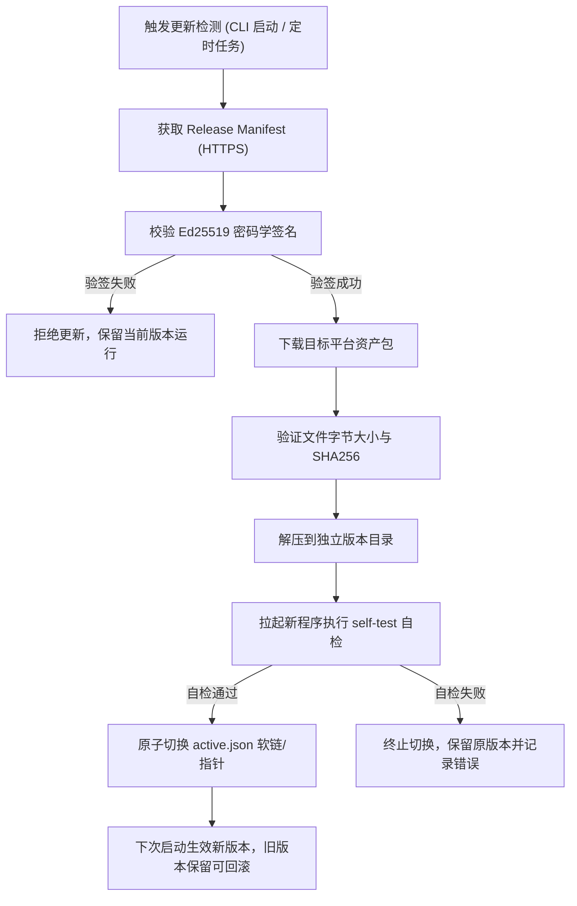

<div align="center">

# 🚀 DYT AShare CLI (`dytcn`)

**面向 A 股高频分钟级历史数据研究与量化 AI Agent 的官方现代化 Rust 命令行工具**

[](https://github.com/renjiegod/dyt-ashare-cli/releases)
[-orange.svg?style=flat-square)](https://www.rust-lang.org/)
[](LICENSE)
[](#-安全机制与自愈更新体系)
[](#-安装指南)
[](#-核心亮点)

<p align="center">
  <a href="#-核心亮点">核心亮点</a> •
  <a href="#-快速上手">快速上手</a> •
  <a href="#-安装指南">安装指南</a> •
  <a href="#-ai-agent-深度赋能">Agent Skills</a> •
  <a href="#-核心命令详解">命令参考</a> •
  <a href="#-a-股交易特性与数据契约规范">数据规范</a> •
  <a href="#-高级配置与环境变量">配置说明</a>
</p>

</div>

> [!NOTE]
> **开发预览说明**：本项目当前处于公开开发预览阶段。数据服务端地址默认为 `https://data.doyoutrade.cloud`。客户端采用 MIT 开源协议，数据服务的账户、额度与套餐由服务端统筹管理；不同金融市场独立交付（加密资产能力归属于独立的 `dyt-crypto` 产品）。

---

## 🌟 核心亮点

`dytcn` 专为量化研究员、算法交易员以及现代 AI Coding Agent 设计，解决传统 Python 数据脚本环境配置繁重、数据版本不可追溯、研究难以重现的痛点：

| 维度 | 传统 Python / 脚本下载方案 | ⚡ `dytcn` Rust 命令行工具 |
|:---|:---|:---|
| **环境依赖** | 需要安装 Python、Pandas、WSL 或 C++ 运行库 | **单个独立可执行程序**，零依赖，Windows 解压即用 |
| **执行性能** | 启动缓慢、脚本解释开销大、内存占用高 | **纯 Rust 编写**，内存安全，微秒级启动，极速解析 |
| **Agent 支持** | 需手写 Prompt 引导大模型拼接各种数据接口 | **原生内置双 Agent Skills**，即插即用（Claude / Cursor 等） |
| **数据分析** | 分析必须编写专用脚本或依赖三方收费接口 | **本地离线零成本分析**，无需服务端配额，秒级输出统计与质检 |
| **数据完整性** | 文件命名混乱、分发易篡改、版本难以重现 | **不可变 UUID + SHA256 校验和**，附带完整 Provenance 归档 |
| **更新与安全** | 手动重新拉取仓库或依赖 pip，风险不可控 | **内置 Ed25519 密码学验签**、原子无缝更新与一键 Rollback |
| **输出格式** | 文本混合日志，脚本解析容易报错 | **纯净 JSON-First 标准输出**，诊断归入 stderr，天生契合管道 |

---

## ⚡ 快速上手

以下是使用 `dytcn` 进行 A 股数据检索、质检与 AI 赋能的典型全流程：

```bash
# 1. 登录服务端账户（终端交互静默输入，密钥不入命令行历史）
dytcn auth login

# 2. 查询当前账户权益与服务配额余量
dytcn usage

# 3. 探查指定股票的数据覆盖区间与不可变版本
dytcn coverage --symbol 600000.SH --from 2026-06-01 --to 2026-06-30

# 4. 查询高频分钟级 K 线数据并原子保存至本地
dytcn minutes --symbol 600000.SH --from 2026-06-01 --to 2026-06-05 --out minutes.json

# 5. 本地离线运行数据质量与描述统计分析（不消耗任何线上额度）
dytcn analyze --input minutes.json

# 6. 一键同步并校验可重现的不可变 Parquet 数据集
dytcn sync --symbol 600000.SH --from 2026-06-01 --to 2026-06-30 --dir ./research

# 7. 将配套 Agent Skills 一键分发到本地 AI 编程工具
dytcn skills install

# 8. 综合检查本地环境与更新状态
dytcn doctor
```

---

## 📦 安装指南

`dytcn` 提供适用于主流操作系统的主流安装方式。Windows 用户可直接使用预编译程序，无需安装任何开发环境。

### 方式一：Windows PowerShell 一键安装（推荐）

在 PowerShell 终端中执行以下命令（自动检测 x64/ARM64 架构、配置用户 PATH、安装 Skills 并注册后台自动更新任务）：

```powershell
powershell -ExecutionPolicy Bypass -c "irm https://data.doyoutrade.cloud/releases/dyt-ashare/install.ps1 | iex"
```

> [!TIP]
> 安装程序默认安装至 `%LOCALAPPDATA%\DYT\AShare`，注册每 6 小时静默执行一次的自检更新计划任务，且不会影响当前正在运行的研究进程。

### 方式二：macOS / Linux 自动化安装

打开终端执行安装脚本：

```bash
curl -fsSL https://data.doyoutrade.cloud/releases/dyt-ashare/install.sh | sh
```

安装完成后将 `$HOME/.local/share/dyt-ashare/bin` 加入系统 `PATH` 即可：

```bash
export PATH="$HOME/.local/share/dyt-ashare/bin:$PATH"
```

### 方式三：便携版直接运行 (Portable)

从 [Releases 页面](https://github.com/renjiegod/dyt-ashare-cli/releases) 直接下载对应平台的独立二进制文件：
- Windows: `dytcn.exe`
- macOS (Apple Silicon): `dytcn-aarch64-apple-darwin`
- macOS (Intel): `dytcn-x86_64-apple-darwin`
- Linux (x86_64): `dytcn-x86_64-unknown-linux-gnu`

下载后赋予可执行权限即可直接运行，便携模式不会触发后台自动安装。

### 方式四：从源码编译安装

如果你拥有 Rust 开发环境（需要 **Rust 1.88+**，使用 2024 Edition）：

```bash
# 克隆仓库
git clone https://github.com/renjiegod/dyt-ashare-cli.git
cd dyt-ashare-cli

# 本地编译并安装到 Cargo bin 目录
cargo install --locked --path .

# 验证安装
dytcn --version
```

---

## 🤖 AI Agent 深度赋能

`dytcn` 不仅是人类量化研究员的利器，更专为大语言模型（LLM）与自动化 AI Agent 深度适配。CLI 二进制内部直接打包了经过精心打磨的 Agent 知识库与操作技能：

```
skills/
├── dyt-ashare-research/    # A 股分钟级数据检索与量化策略研究专家
└── dyt-ashare-quality/     # 数据完整性核验、时段审计与可重现性分析
```

### 1. 内置 Skills 详解

* **`dyt-ashare-research`**：
  - 引导 Agent 遵循 A 股市场特定规则（自动补全交易所前缀 `.SH` / `.SZ` / `.BJ`）。
  - 在执行大规模抽取前自动规划 `dytcn usage` 额度评估与 `coverage` 时间窗口探查。
  - 严格提醒 Agent：原始价格变动不等于交易收益（必须考虑分红除权除息），避免模型得出脱离现实的策略胜率。
* **`dyt-ashare-quality`**：
  - 指导 Agent 调用 `analyze` 对输入 JSON 数据实施严格的质量核验。
  - 自动审查 A 股每日标准 240 根分钟线基准、早盘集合竞价标识、时间戳重复与非交易时段异动。
  - 确保量化回测的输入数据具备密码学级别的可重现性证据。

### 2. 一键安装与适配支持

通过以下命令将内置 Skills 导出到主流 AI 辅助工具的技能库：

```bash
# 默认分发到标准技能目录 (~/.agents/skills)
dytcn skills install

# 或指定安装到当前项目的自定义技能目录
dytcn skills install --dir ./.agents/skills
```

支持即插即用的 AI 研发环境：
- **Cursor** / **Windsurf**：在 Project Rules 或 Agent Settings 中自动加载。
- **Claude Code** / **Claude Desktop**：配合 MCP 或原生本地提示词工作流。
- **Google Antigravity** / **OpenCode** / **Codex**：作为本地工作区专业金融技能无缝调用。

---

## 🛠️ 核心命令详解

`dytcn` 严格遵循 Unix 哲学：**标准输出（stdout）全部为可解析的 JSON 字符串**，任何交互日志、排障诊断和错误跟踪均写入标准错误输出（stderr），操作失败时返回非零退出码。

```
dytcn [GLOBAL_OPTIONS] <COMMAND>
```

**全局参数 (Global Options)**：
- `--home <PATH>` 或 `DYT_ASHARE_HOME`：指定本地数据与状态主目录（默认 Windows 为 `%LOCALAPPDATA%\DYT\AShare`，Unix 为 `~/.local/share/dyt-ashare`）。
- `--api-url <URL>` 或 `DYT_ASHARE_API_URL`：指定服务端 Origin（默认为 `https://data.doyoutrade.cloud`）。
- `--out <PATH>`：将命令输出结果以原子写入方式落地为本地文件，stdout 仅输出文件路径、字节数与 SHA256 校验和。
- `--no-update` 或 `DYT_ASHARE_NO_UPDATE=1`：在 CI 或受控环境中临时禁用自动更新检测。

---

### 1. 认证管理 (`dytcn auth`)

第一版数据服务由运营方统一签发账户密钥（API Key）。为杜绝敏感凭据泄露，密钥以交互隐藏方式输入，绝不允许放入 CLI 参数或出现在终端历史记录中。

```bash
# 交互式安全登录（输入内容不可见）
dytcn auth login

# 管道输入（适用于 CI / 无人值守自动化流程）
echo "ask_xxxxxxxxxxxxxxxxxxxxxxxxxxxxxxxxxxxxxxxxxxxxxxxxxxxxxxxxxxxxxxxx" | dytcn auth login --stdin

# 查看当前认证状态与环境变量生效情况
dytcn auth status

# 清除本地保存的凭据
dytcn auth logout
```

### 2. 权益与用量监控 (`dytcn usage`)

查询服务端登记的账户等级、服务到期时间、总配额以及当前分钟线用量统计：

```bash
dytcn usage
```

<details>
<summary>📋 点击展开示例输出 (JSON)</summary>

```json
{
  "account_id": "acc-research-01",
  "tier": "professional",
  "expires_at": "2027-12-31T23:59:59Z",
  "minutes_quota_monthly": 10000000,
  "minutes_consumed_monthly": 142560,
  "remaining_quota": 9857440
}
```
</details>

### 3. 数据覆盖度探查 (`dytcn coverage`)

在批量下载或回测前，先探查特定标的在指定区间内可用的历史不可变数据集版本。

```bash
dytcn coverage --symbol 600000.SH --from 2026-01-01 --to 2026-06-30
```

> [!NOTE]
> 数据集以不可变月份为粒度归档。返回列表中某一月份缺失表示该区间暂无归档数据，不代表该区间全部为法定休市日。

### 4. 分钟级 K 线查询 (`dytcn minutes`)

查询指定股票在时间窗口内的高频分钟数据。单次请求最多支持 31 个自然日，日期参数基于上海时区（Asia/Shanghai），日期终点 `--to` 包含当日收盘。

```bash
# 直接在终端输出 JSON 结果
dytcn minutes --symbol 600000.SH --from 2026-06-01 --to 2026-06-05

# 使用 --out 原子保存到本地文件（推荐用于后续分析与存档）
dytcn minutes --symbol 600000.SH --from 2026-06-01 --to 2026-06-05 --out minutes.json
```

输出反馈示例（`--out` 模式）：
```json
{
  "output_path": "/Users/research/minutes.json",
  "bytes": 285420,
  "sha256": "8f4a13c9e6d0a7f1a3298a0cbe445df3320f269a8b1ec45674c30c4e4ef65c71"
}
```

### 5. 本地离线零成本分析 (`dytcn analyze`)

直接在本地对 `minutes --out` 生成的 JSON 数据进行深度统计与质量体检。**该过程 100% 在本地执行，不产生任何网络流量与服务端配额扣减**：

```bash
dytcn analyze --input minutes.json
```

<details open>
<summary>📋 本地离线分析输出示例 (JSON)</summary>

```json
{
  "cli_version": "0.1.0",
  "input_sha256": "8f4a13c9e6d0a7f1a3298a0cbe445df3320f269a8b1ec45674c30c4e4ef65c71",
  "symbol": "600000.SH",
  "rows": 960,
  "first_bar": "2026-06-01 09:31:00",
  "last_bar": "2026-06-05 15:00:00",
  "raw_close_change": 0.024512,
  "raw_close_max_drawdown": 0.011804,
  "volume_shares": 18452300.0,
  "turnover_cny": 196320450.0,
  "observed_day_rows": {
    "2026-06-01": 240,
    "2026-06-02": 240,
    "2026-06-03": 240,
    "2026-06-04": 240
  },
  "observed_days_with_partial_or_invalid_counts": [],
  "duplicate_timestamps": 0,
  "invalid_ohlcv": 0,
  "off_session_timestamps": 0,
  "interpretation": "unadjusted descriptive statistics; not strategy returns; no certified calendar or fee model"
}
```
</details>

**核心质检指标说明**：
- `observed_day_rows`：每日实际观测到的有效分钟 K 线数量（A 股标准全交易日基准为 240 根）。
- `observed_days_with_partial_or_invalid_counts`：缺失、早收或异常的分秒日明细列表。
- `invalid_ohlcv`：极端行情非法数值计数（如 High < Low、Close <= 0、价格非有限数值等）。
- `off_session_timestamps`：非标准 A 股交易时段（不在 09:31-11:30 或 13:01-15:00 范围）的时间戳。
- `duplicate_timestamps`：重复时间戳统计。

### 6. 不可变 Parquet 数据集同步 (`dytcn sync`)

用于研究库的大规模归档。`sync` 会校验服务端目录中的每个不可变数据切片（UUID v4），按大小与 SHA256 校验和原子落地为 `.parquet` 与 `.manifest.json`，并汇总生成 `catalog.json`。

```bash
dytcn sync --symbol 600000.SH --from 2026-01-01 --to 2026-06-30 --dir ./data/parquet
```

- **增量跳过**：重复执行时，本地哈希比对一致的文件将被直接跳过（`verified_skipped`），节省带宽。
- **版本保留**：当数据产生修订时，旧版本 Parquet 仍保留在磁盘上以保证旧回测完全可复现，当前主索引统一由 `catalog.json` 指定。
- **越权保护**：若所请求区间跨越了历史权限边界，未授权部分将标记为 `restricted_downloads` 并在客户端受限保护。

### 7. 系统综合诊断 (`dytcn doctor`)

在排查问题或进行环境交付前，使用 `doctor` 一键获取当前 CLI 版本、二进制路径、状态目录、服务来源、更新状态与已安装 Skills 状态：

```bash
dytcn doctor
```

### 8. 自愈更新与版本管理 (`dytcn update`)

`dytcn` 内置了完整的自愈与更新机制，所有更新包均由 Ed25519 密钥签名。

```bash
# 检查更新状态与当前激活版本
dytcn update status

# 立即触发一次验签更新检测
dytcn update

# 回滚到上一个稳定版本并暂停自动更新
dytcn update rollback

# 重新启用或禁用周期性后台自动更新
dytcn update enable
dytcn update disable
```

---

## 📊 A 股交易特性与数据契约规范

量化研究容不得模糊假设。`dytcn` 在数据模型上严格尊重中国 A 股市场的特有规则：

```
                09:15-09:25       09:30           11:30   13:00           15:00
市场状态 --------| 早盘集合竞价 |------|---- 连续竞价 ----|-------|---- 连续竞价 ----|---- 收盘
K 线输出 ---------------> [09:31 K线包含竞价] --------------> [上午 120 根]  [下午 120 根] = 共 240 根/日
```

### 1. 证券代码与交易所后缀
必须显式指定交易所后缀，目前支持的格式包括：
- 上海证券交易所：`600000.SH`、`688001.SH`
- 深圳证券交易所：`000001.SZ`、`300750.SZ`
- 北京证券交易所：`830946.BJ`

### 2. 交易时区与标准时间戳
- **时区标准**：全链路采用北京时间 **Asia/Shanghai (UTC+8)**。
- **闭区间语义**：纯日期格式的 `--to 2026-06-05` 自动展开为 `2026-06-05 23:59:59`，确保完整包含该交易日全天数据。

### 3. 分钟 K 线结构与集合竞价
- **240 根标准交易日**：全天正常交易日由上午 120 根（09:31 至 11:30）和下午 120 根（13:01 至 15:00）构成。
- **09:31 柱线**：第一根 1 分钟线的时间戳通常标记为 `09:31:00`，成交量与成交额中已包含早盘 09:15-09:25 的集合竞价成交结果。

### 4. 价格、成交量与除权除息契约
- **不复权价格 (Unadjusted)**：所有 `px_open`, `px_high`, `px_low`, `px_close` 均为真实历史不复权行情。
- **成交量与成交额**：`volume_shares` 单位为股（Shares），`turnover_cny` 单位为人民币元（CNY）。
- **策略严谨性**：原始价格变化与最大回撤（`raw_close_change` / `raw_close_max_drawdown`）仅作为数据描述性指标，**不可直接作为策略真实收益**。当标的发生分红、送转股或配股等除权除息行为时，应在量化引擎中结合复权因子单独处理。

---

## 🔐 安全机制与自愈更新体系

`dytcn` 将研究环境的安全性与确定性置于首位：



1. **密码学完整性保障**：
   - 更新包通过内置的 Ed25519 公钥（`release-public-key.hex`）进行身份验签，防止任何中间人攻击或恶意镜像劫持。
   - 每个资产严格匹配 SHA256 与字节长度双重审计。
2. **进程隔离与原子切换**：
   - 正在运行的研究任务或回测不会被中断（旧进程继续占用原有镜像）。
   - 通过 `active.json` 进行原子激活，升级失败自动回退，不破坏现有运行目录。
3. **敏感凭据本地作用域隔离**：
   - 凭据仅存储在用户专属的本地状态目录中，且严格绑定服务 Origin。
   - 当向对象存储下载 Parquet 数据或发生 302 重定向时，`dytcn` 会自动剥离 Authorization Bearer 凭据头，防止密钥泄漏至第三方存储节点。
4. **零后台遥测**：
   - 不收集任何研究标的、查询习惯或量化代码信息，专注纯粹的数据通道交付。

---

## ⚙️ 高级配置与环境变量

`dytcn` 支持通过命令行参数或环境变量进行全局配置，环境变量非常适用于 CI/CD 自动化流水线：

| 环境变量 | CLI 等价参数 | 默认值 | 作用与说明 |
|:---|:---|:---|:---|
| `DYT_ASHARE_HOME` | `--home <PATH>` | 见下文 | 本地状态根目录，存放凭据、缓存数据集、Skills 及更新版本 |
| `DYT_ASHARE_API_KEY` | *(交互输入)* | *(无)* | 显式提供 API Key（`ask_...` 格式），优先于本地保存的凭据 |
| `DYT_CN_API_KEY` | *(交互输入)* | *(无)* | `DYT_ASHARE_API_KEY` 的向前兼容别名 |
| `DYT_ASHARE_API_URL` | `--api-url <URL>` | `https://data.doyoutrade.cloud` | 数据服务端 API 基础地址（仅允许 HTTPS 或 loopback 本地地址） |
| `DYT_ASHARE_NO_UPDATE` | `--no-update` | `false` | 设为 `1` 或 `true` 时，禁止一切后台自动更新与定时检测 |

> 默认状态根目录：
> - Windows: `%LOCALAPPDATA%\DYT\AShare`
> - Linux / macOS: `~/.local/share/dyt-ashare`

---

## 🛠️ 开发者指南

我们欢迎社区贡献！客户端代码遵循 Apollo GraphQL 与 Rust 官方最佳实践。

### 本地编译与验证

```bash
# 格式化代码校验
cargo fmt --check

# Clippy 严格静态检查
cargo clippy --all-targets --locked -- -D warnings

# 运行全套单元测试与行为断言
cargo test --locked

# 或直接运行仓库提供的自动化本地测试门禁
bash scripts/test.sh
```

关于完整的 Ed25519 签名发布打包、多架构交叉编译、Windows MSVC 静态 CRT 链接与端到端更新测试细节，请参阅 [DEVELOPING.md](DEVELOPING.md)。

---

## ⚖️ 免责声明与开源协议

### 免责声明 (Disclaimer)
1. 本项目及其所提供的数据工具仅供**学术研究、量化数据处理与技术开发**交流使用，不构成任何形式的投资建议、买卖要约或金融决策依据。
2. 股市有风险，投资需谨慎。用户应对基于本项目数据运行的策略模型、交易决策及其盈亏结果承担全部责任。
3. 数据源及本软件不保证历史行情数据的绝对无遗漏或完全不间断，在实盘环境中请配合独立的风控系统使用。

### 开源协议 (License)
本项目客户端采用 [MIT License](LICENSE) 开源。
